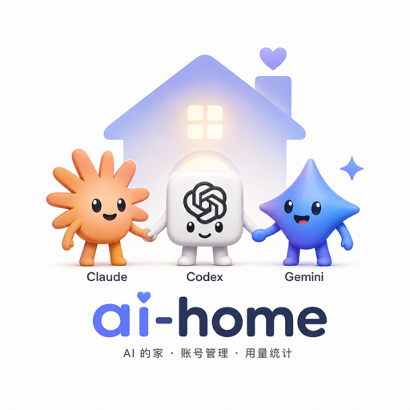

<p align="center">
  
</p>

# ai-home

`ai-home`（命令 `aih`）在一台机器上管理多个 AI CLI 的多账号，并内置一个 OpenAI / Anthropic / Gemini 兼容网关（**AIH Server**）：对外一个端点，背后在多账号、多 provider 之间按额度路由，按（账号, 模型）熔断，按模型别名的优先级降级。CLI 会话默认跑在持久 tmux 里，关终端、断 SSH 都不会丢。

支持的 CLI：`codex`、`claude`、`gemini`、`agy`（Antigravity）、`opencode`、`grok`、`kimi`、`kiro`、`qoder`、`qodercn`、`zcode`、`codebuddy`、`codebuddycn`、`workbuddy`、`workbuddycn`、`cline`。上游 Gemini CLI 已停止服务，Google 账号请改用 `agy`。

部分 provider 还可以在 WebUI 的账号页里按账号打开桌面 App（例如 Codex、Claude、Kimi、ZCode、WorkBuddy、CodeBuddy），具体以账号页实际显示为准。

## 设计原则

- **账号之间只隔离凭据。** 每个账号的目录（`~/.ai_home/run/auth-projections/<provider>/<accountRef>/`）里只放该账号的凭据。
- **会话在原生位置，所有账号共用一份。** 会话、历史、设置和工具缓存都留在各工具自己的目录里（如 `~/.codex/sessions`、`~/.claude/projects`、`~/.kiro/sessions`），宿主和各账号看到的是同一份，换账号不会让会话"消失"。
  - agy 是唯一例外：它固定从 `$HOME` 读凭据，所以启动时 HOME 指向账号目录，会话仍共享 `~/.gemini/antigravity-cli`。
  - 桌面 App 中，WorkBuddy 的数据目录整体共享宿主；CodeBuddy IDE 和 ZCode 只共享会话存储，因为登录态和会话在同一个目录里。
- **aih 自己的数据只放在 `~/.ai_home`**（可用 `AIH_HOME_DIR` 改到别处），不在宿主 home 另建目录，也不留备份文件。

## 安装

### 安装包（推荐，无需预装 Node）

每个平台一个文件，内置 Node 22、npm、生产依赖和构建好的 WebUI：

| 平台 | 单文件 |
|---|---|
| macOS Apple Silicon | `aih-<version>-darwin-arm64.run` |
| macOS Intel | `aih-<version>-darwin-x64.run` |
| Linux x64 / arm64 | `aih-<version>-linux-x64.run` / `-linux-arm64.run` |
| Windows x64 / arm64 | `aih-<version>-win32-x64.exe` / `-win32-arm64.exe` |

```bash
chmod +x aih-<version>-<target>.run
./aih-<version>-<target>.run          # 首次运行自动解包
```

把文件放进 `PATH`（例如 `~/.local/bin/aih`）即可长期使用。目录归档（`.tar.gz` / `.zip`）解压后运行 `install.sh` / `install.ps1` 可安装到用户目录并写入 PATH。Windows 直接运行 `.exe` 即可；用 `.zip` 时 `install.ps1` 会把程序放进 `%LOCALAPPDATA%\aih` 并加入用户 PATH。

- 数据仍在 `~/.ai_home`，升级或删除程序不会动账号
- 单文件首次运行解包到 `~/.ai_home/pkg/<version>-<target>-<sha8>/`；升级后旧目录可手动删除
- 分发包用 `aih update --check` 只会提示下载新安装包，不要用 npm 原地更新
- 构建方法、产物布局与验证命令见 [docs/packaging.md](docs/packaging.md)

macOS / Linux 建议安装 `tmux`；Windows 会自动使用 `psmux` 或 MSYS2 / Cygwin 的 `tmux.exe`。

### 从源码

需要 Node.js 22。

```bash
cd ai_home
npm install       # 同时安装并构建 WebUI
npm link          # 把 aih 命令装到 PATH，指向这份源码
```

更新：在仓库目录执行 `git pull --ff-only`；如果 WebUI 有变化，再执行 `npm run build`；最后 `aih server restart`。`aih update --check` 会显示当前的安装来源。

## 账号

### 启动用哪个账号

| 命令 | 使用的账号 |
|---|---|
| `aih codex`、`aih claude`、`aih opencode`、`aih kimi`、`aih cline`（可带原生参数） | **AIH Server**：请求走网关账号池，不锁定某个账号 |
| `aih <cli> .aih-server [args]` | 显式指定 AIH Server（仅限上面 5 个 provider） |
| `aih <cli> <id> [args]` | 指定的账号 |
| `aih agy`、`aih grok`、`aih kiro`、`aih qoder`、`aih codebuddy` 等其他 provider（不带 ID） | 默认账号；没有设置默认账号时用 1 号账号 |

**默认账号**（`set-default <id>`）：

- 对 codex、claude、opencode、kimi、cline：只决定**不经 aih** 直接运行的原生 CLI（终端里的 `codex`、`claude`、IDE 插件等）和桌面 App 用哪个账号，不影响 `aih <cli>` 的裸启动。
- 对其他 provider：除上面的作用外，也决定 `aih <cli>` 裸启动用哪个账号。
- `aih codex|claude|opencode|kimi|cline set-default`（不带 ID）：让宿主上的原生 CLI 也改走 AIH Server。

### 常用命令

```bash
aih ls                                # 所有工具的账号与状态
aih codex ls                          # 某个工具的账号
aih '*buddy*' ls                      # provider 位支持通配 * / ?（加引号，别让 shell 先展开）
aih '*buddy' ls                       # 后缀匹配：codebuddy、workbuddy
aih ls --scope codebuddy workbuddy    # 等价写法：显式列 provider（也可用逗号）
aih provider ls                       # provider 目录：各自多少账号、有没有原生 CLI

aih codex login                       # 新增账号并登录（浏览器）
aih codex login --no-browser          # 无浏览器 / 设备码登录
aih codex login api_key               # 新增 API Key 账号（交互输入 Key 与可选 Base URL）

aih codex 3                           # 用 3 号账号启动
aih codex 3 exec "fix the tests"      # 原生参数照常透传
aih codex 3 --model gpt-5 --model-alias gpt-5-mini   # 本次会话请求 gpt-5 时实际用 gpt-5-mini
aih codex 3 --model-alias gpt-5-mini                 # 省略 --model：本次会话任何模型都落到 gpt-5-mini
aih codex 3 home                      # 查看该账号实际使用的 HOME / 配置路径

aih codex usage 3 --refresh           # 查询并刷新单个账号额度
aih codex usage                       # 扫描全部账号（-j N 控制并发）

aih codex set-default 3               # 设置默认账号（作用见上）
aih codex set-default                 # 宿主原生 CLI 改走 AIH Server
aih codex unset-default
aih codex --restart-client            # 重启 / 启动已识别的桌面 App
aih codex set-mobile 3                # 设置 Codex App 账号（仅 ChatGPT OAuth 账号）
aih codex unset-mobile
aih claude set-default 2 --desktop-mode web --restart-client   # Claude Desktop：web 或 api 模式
aih codex policy set workspace-write  # codex exec 沙箱策略（read-only / workspace-write / danger-full-access）
aih codex auto-switch on --remaining 10   # 原生模式额度见底 / 429 时自动换号并续接会话（默认关闭）
aih codex auto-switch status              # 查看开关与触发阈值

aih codex delete 1,2,3                # 也支持 1-9 这样的范围
aih codex deleteall
aih codex terminal-icon --install     # 为当前终端安装 provider 图标

aih desktop status                    # 桌面端总览：canonical / 影子副本 / 运行中实例 / 漂移
aih provider capabilities --json      # 各 provider 的资源边界与缺口
aih claim --dry-run                   # 每日签到 / 活动福利：先看有什么可领
```

## 导入导出

```bash
# 格式：aih 本机原生账号 JSON（与 WebUI「导出 / 导入」同一份），所有 provider 无损往返。
# 文件含明文凭据（token / API key），请妥善保管。
aih export                                    # 全部账号 → aih-accounts-<date>.json
aih export codex claude:1,2 mine.json         # 选择器：provider、provider:编号、或 acct_… 账号引用
aih codex export 3                            # 单个账号（aih codex 3）

aih import mine.json                          # 同一身份更新原账号，新身份新增，重复导入不会多出账号
aih import mine.json --dry-run                # 只解析统计，不写入
aih codex import mine.json                    # 只导入文件里的 codex 账号

aih codebuddy detect                          # 扫描本机已登录账号（CodeBuddy / WorkBuddy 家族与 cline）并入库
```

- **导入来源**：目录、zip（含嵌套 zip）、单账号 JSON、JSONL、手动粘贴的 JSON、CLIProxyAPI 配置与 auth-dir（仅 codex / gemini / claude）、sub2api 的 `sub2api-data` / `sub2api-bundle`、Antigravity-Manager 的 JSON。
- **去重**：同一身份已存在时跳过，不覆盖已有凭据。
  - OAuth 账号按各 provider 稳定的账号标识判断，例如 codex 的用户 ID、claude 的账号 UUID；gemini 和 agy 按邮箱。
  - API Key 账号按 provider + 规范化后的 URL + Key 判断。
- **sub2api 元数据**：`notes`、`proxy_key`、`priority`、`concurrency` 等字段会保存下来，再次导出 sub2api 时原样带回。
- **账号编号**：aih 内部用 `accountRef` 唯一标识账号，CLI 里的数字 ID 只是别名。导入到另一台机器时会重新分配数字。

### 远程自动备份（SSH）

```bash
aih backup add me@backup-host             # 添加目标，可加多个
aih backup add me@vps2 --key ~/.ssh/id_ed25519 --remote-dir ~/aih-backup
aih backup list                           # 目标与最近一次结果
aih backup run                            # 立即备份（默认只传变化的账号）
aih backup restore me@backup-host --dry-run
```

- 账号新增 / 导入（含同身份换凭据）/ 删除 / 启停后由 `aih server` 自动增量备份；token 刷新按 `interval`（默认 360 分钟）周期补跑，事件去抖 30 秒。
- 增量按账号内容 sha256 比对，未变化的账号不重传；远端按 `accounts/<provider>/<acct_…>.json` 存放，`manifest.json` 记录版本与删除墓碑。
- 密码只从 `--password-env` 指定的环境变量读取，不落盘；首次连接记录主机指纹（TOFU），之后不匹配直接拒绝。
- 设计细节见 [docs/architecture/remote-account-backup.md](docs/architecture/remote-account-backup.md)。

## AIH Server（内置网关）

```bash
aih server start                  # 后台启动（不带参数的 aih serve 与之相同）
aih server status
aih server restart
aih server stop
aih server serve --port 9527      # 前台运行
aih daemon status                 # aih daemon 是 aih server 的别名

aih server autostart install      # 开机自启；还有 status / uninstall
aih server config show            # 加 --show-secrets 才显示真实密钥
aih server config set --client-key <key>
```

- **默认监听**：`http://127.0.0.1:9527`。
- **兼容端点**：OpenAI（`/v1/chat/completions`、`/v1/responses`、`/v1/models`）、Anthropic（`/v1/messages`）、Gemini（`/v1beta/...`）。外部工具把 `base_url` 设为 `http://127.0.0.1:9527/v1` 即可。
- **Client Key**：没有配置时，任意 key 都能调用；配置后，请求必须带这个 key。
- **代码更新**：源码有变化时，`aih server status` 会显示 `stale`，执行 `aih server restart` 生效。运行中的请求不会被自动打断。
- **生命周期命令**：`start` / `restart` / `stop` / `status` 管理单实例，不接收端口参数，使用已保存的 Server 配置。
- **自启位置**：
  - macOS：`~/Library/LaunchAgents/com.clawdcodex.ai_home.plist`（launchd 直接运行 `aih`）
  - Linux：`~/.config/systemd/user/com.clawdcodex.ai_home.service`（用户级 systemd；无人登录时也要运行，需要启用 linger）
  - Windows：启动文件夹里的 `com.clawdcodex.ai_home.vbs`（远程 / 计划任务拉起用 `~/.ai_home/run/aih-server-start.cmd`）

### 模型别名与调度

- **模型别名**（WebUI 设置页）：把对外的模型名映射到真实模型，支持通配（如 `claude-*`）和优先级。同名的多条规则按优先级组成 fallback 链。通配规则不会出现在 `/v1/models` 列表里，但请求时照常解析。
- **选号**：按各账号的剩余额度加权。
- **熔断**：429 和额度耗尽按（账号, 模型）熔断。某账号的一个模型被限流，它的其他模型照常可用。
- **降级**：某个别名目标在所有账号上都不可用时，自动降级到下一条优先级的别名。
- **单次会话改写（`--model-alias`）**：`aih <cli> <id> --model A --model-alias B` 让**本次启动**请求 A 时实际用 B；省略 `--model` 时任何模型都落到 B。和上面的持久别名是两回事——它不落库、退出即失效，优先级更高（在别名解析之前生效），换 provider、选号都不受影响。
  - 送达方式按 CLI 能力分两种：claude / codex 走自定义请求头；gemini、codebuddy 家族、kimi、cline、opencode 这类没有可追加头的原生 CLI，把规则编进网关 base URL 的路径前缀（`/-/ma/<token>`），网关在路由匹配前剥掉。
  - qoder / zcode 的推理地址写死在客户端里、没有注入点，只能在启动时改写 `--model`，因此**必须同时给 `--model`**。

### 图片生成与编辑

- **接口**：`POST /v1/images/generations`（文生图）和 `POST /v1/images/edits`（图生图）。
  - 请求字段兼容 OpenAI：`model`、`prompt`、`n`（1–10）、`size`、`quality`、`response_format`。
  - 编辑接口接受 multipart 上传或 JSON data URL，支持 png / jpeg / webp，单张不超过 4 MiB，最多 16 张，可带 `mask`。
  - `response_format=url` 时，图片存入本机 blob 存储，返回 `/v1/blobs/<id>`。
- **按账号类型选择实现**：
  - API Key 账号：直通上游的 Images API。
  - codex OAuth 账号：使用 ChatGPT Codex Images（`gpt-image-2`，最多 5 张参考图）。
  - agy / gemini OAuth 账号：`gemini-*-image` 系列模型。
  - grok OAuth 账号：xAI Images（最多 3 张参考图）。
- **报错**：某个 provider 或模型不支持的参数会明确报错，不会被静默丢弃。

## Web UI

服务启动后打开 `http://127.0.0.1:9527/ui/`。WebUI 和管理接口即使从本机访问，也需要 Management Key（见下文）。

页面：

- 仪表盘
- 账号管理：登录、额度、导入导出、按账号打开桌面 App 或终端
- AI 会话：网关会话，以及各 provider 的原生会话续写
- 模型用量
- 模型目录
- 开发工具
- AI 生图
- Server 管理、SSH 开发机
- 设置：Server 配置、模型别名等

手机上有单独的移动端布局，也可以作为 Web App 安装。

## 远程 Server 与 SSH 开发机

只有三个概念：

- **Server**：运行网关和管理接口，持有账号、模型、会话、SSH 配置。
- **Client**：浏览器 / Web App 和 CLI，可以保存多个 Server 并随时切换。
- **SSH 开发机**：由 Server 保存的 SSH 连接与工作区，用于远程开发。

客户端连接 Server 只需要 **Server URL + Management Key**。

- Management Key 具有完整管理权限，所有可信客户端共用同一把。
- 跨不可信网络时，请通过 HTTPS、VPN 或受控隧道暴露 Server。
- 浏览器会把 Server URL 和 Management Key 存在浏览器存储里，只应在受信任的浏览器里使用。

在 Server 上开放局域网访问：

```bash
aih server config set --open-network --generate-management-key
aih server restart
aih server config show --show-secrets   # 查看密钥（只在受信任的终端里用）
aih server config show --show-secrets --qr  # 手机扫码填写 Server URL 和 Management Key
aih server config show --show-secrets --qr --qr-url https://aih.example.com
```

把 Server 暴露到公网时，用 `aih edge` 生成 frp / nginx / caddy 配置（先校验后落地，失败自动回滚）：

```bash
aih edge status                          # 查看本机入口转发现状
aih edge plan frp --remote-port 9527     # 预览配置改动
aih edge apply frp --remote-port 9527    # 写入配置（--dry-run 只预览不写）
```

WebUI「开发工具 → 入口与转发」是同一套配置的界面。

在另一台机器的 CLI 上保存并切换 Server：

```bash
aih server add home --url http://192.168.3.181:9527 --management-key "<management-key>"
aih server ls          # 只显示是否已配置密钥，不输出原文
aih server use home
aih server remove home
```

浏览器里在「Server 管理」页填写同样的 URL 和 Management Key。已认证的客户端可以在该页轮换密钥，也可以在 Server 上执行 `aih server config set --generate-management-key`。

手机可在 Management Key 输入框旁点「扫描二维码」，识别终端里的凭据二维码，填入地址和密钥后再提交。二维码包含完整管理密钥，只应展示给你信任的设备。`--qr` 默认从监听配置和可用网卡选择地址；公网、HTTPS 或 VPN 地址可用 `--qr-url` 指定。终端二维码需要足够的窗口宽度；过长的自定义密钥可能超过二维码容量，仍可手动输入。

普通配置更新和空白输入会保留已有 Management Key。清理密钥会关闭管理面，必须显式执行 `aih server config set --clear-management-key --confirm-clear-management-key`，随后重启生效。诊断和页面验收应使用隔离数据目录，保留用户正在使用的密钥；不要临时替换后再清空。

部署到远端服务器（二进制，不在远端装依赖）：

```bash
npm run pkg:build -- --targets linux-x64           # 产出 dist/release/aih-<version>-linux-x64.run
npm run deploy:server -- --ssh me@host --artifact dist/release/aih-<version>-linux-x64.run
npm run deploy:server -- --ssh me@host --artifact <包> --dry-run  # 只打印上传路径与安装脚本，不连远端
```

安装脚本会停旧服务、把上一版留成 `aih.prev`、换上新二进制、`aih server autostart install` 后重启并轮询 `/readyz`，失败自动回滚。Windows 目标自动改用 `scp` + PowerShell。细节见 [docs/packaging.md](docs/packaging.md)。

> `aih codex` 等使用的内置 `.aih-server` 是 provider 的启动 profile，和这里保存的远程 Server 是两回事。

## 持久会话

`aih` 用 tmux 把每个 CLI 会话放在后台持久进程里，关终端、SSH 断线、合盖睡眠都不会丢。直接运行总是**新建**会话；要回到已有会话用 `sessions` 选择器，要接着上一段对话用 `resume`。

```bash
cd ~/projA && aih claude     # 新建会话（AIH Server）
aih resume                   # 跨 provider 选一段会话继续（可带关键词过滤）
aih claude sessions          # 列出 claude 所有账号和 AIH Server 的会话，选中后按 Enter 进入
aih claude 1                 # 用 1 号账号新建会话
aih claude sessions 1        # 只看 1 号账号的会话
aih claude 1 -S debug        # 具名会话：不存在就新建，已存在就进入
aih claude 1 -R              # 接管本项目最近的会话（原来的终端被挤下线）
aih claude 1 -M              # 镜像本项目最近的会话（两边同屏，谁都不挤掉谁）
aih claude resume            # 续接最近一段对话（翻译成各 provider 的原生 resume）
aih claude 1 resume <会话ID> # 指定账号 + 指定会话续接
aih claude fork              # 从最近一段分叉出新会话（原对话不动）
aih ss                       # 所有工具的会话总览（--list 只预览）
```

- **空闲回收**：打开 `aih ss` / `aih <cli> sessions` 时，以及 `aih server` 每 30 分钟，会回收空闲会话。空闲超过 1 天（`AIH_SESSION_IDLE_TTL_MINUTES`，默认 1440）直接释放；空闲会话最多保留 10 个（`AIH_SESSION_MAX_IDLE`），超出按最久未活动优先淘汰。有客户端附着的会话永不回收；「最近激活」取输出与附着/交互时间的较大值，所以差一分钟到期时被打开会重新计时。`AIH_SESSION_REAP=0` 关闭回收。
- **跨 provider 续聊**：`aih resume [关键词]` 不指定 CLI，按标题过滤后直接续；`--provider` / `--account` 收窄范围，`--limit` 控制条数，`--json` 给脚本用。
- **选择器标记**：`●` 表示正被别处占用，`○` 表示空闲。
- **长参数**：`-S`、`-R`、`-M` 是 aih 自己的开关，对应 `--session`、`--aih-resume`、`--aih-mirror`；它们不会吞掉原生的 `--resume` 等参数。
- **续接与分叉**：`resume` 把「接着上次聊」翻译成各 provider 的原生恢复参数；`fork` 从上一段对话分叉出新会话、原对话不动（无分叉能力的 provider 会明确拒绝）。不带 ID 时用「最近一段」（cline 必须给 ID，kimi / kiro 的入口在 TUI 内）。对应关系见 `aih <cli> resume --help`。
- **原生透传**：`aih <cli> -- <任意原生参数...>` 把 `--` 之后逐字交给原生 CLI，即使撞上 aih 的保留字（`ls`、`login`、`resume`…）也不会被拦截。
- **socket 命名**：每个账号一个 tmux server，socket 为 `aih-<provider>-<accountRef>`；AIH Server 的会话用 `aih-<provider>-gateway`。

tmux 常用操作（指挥键 `Ctrl-b`：先按 `Ctrl-b` 松开，再按下一个键）：

| 想做什么 | 怎么做 |
|---|---|
| 暂时离开、让它在后台继续跑 | `Ctrl-b` 然后 `d` |
| 往回翻历史 | 鼠标滚轮，或 `Ctrl-b` 然后 `[`，按 `q` 退出（保留 5 万行） |
| 彻底结束会话 | 在工具里用它自己的退出命令正常退出 |
| 强制结束卡死的会话 | `tmux -L aih-claude-<accountRef> kill-session -t <会话名>` |

不想用 tmux：`AIH_NO_PERSIST=1 aih claude 1`，直接前台运行，断线即丢。

在另一台电脑接着干：`ssh` 回到这台机器，进入项目目录，运行 `aih claude sessions` 选中原来的会话即可。

### 自动换号（原生模式）

用 `aih codex 1`、`aih claude 2` 这种**指定账号**的启动方式时，账号是进程启动时读进内存的。打开自动换号后，额度见底、或上游返回 429 并给出恢复时刻时，aih 会用下一个可用账号重启这个会话，并**续接同一段对话**——不用退出，也不用再手动 `resume`。

```bash
aih codex auto-switch on --remaining 10   # 剩余 ≤10% 就换；省略 --remaining 则跟随 threshold_pct
aih codex auto-switch status              # 查看开关与阈值
aih codex auto-switch off
```

- 默认**关闭**，设置是全局的（额度事实与账号池本来就跨 provider 共用一套）。
- 只影响原生模式。`aih codex`（走 AIH Server）由网关按池调度账号，不需要换号。
- 会话内随时按 **Ctrl-Alt-A** 手动换到下一个可用账号。
- 429 只有在上游给出恢复时刻时才换（没有时刻的短促限流等它自己过去，避免白折腾）；恢复时刻不足 1 分钟不换，超过 24 小时的提示按 24 小时封顶。命中过的账号在冷却期内不会被选为目标。
- 换号时标题显示 `⇄ Codex 已自动换号 1→2`，上一段对话的内容仍在；旧账号的 tmux 会话只是被分离，不会被杀掉。
- 只影响本次会话：`AIH_RUNTIME_USAGE=auto_switch=1,auto_switch_remaining=100 aih codebuddy 1`。

## 外部 harness

`aih harness` 把外部 agent harness（`pi` / `dsh` / `dsh-tui`）接到某个 provider 的某个账号上。harness 自己不发请求，经本地网关转发，所以账号、选号、熔断、模型别名全都复用网关那一套。

```bash
aih harness                                        # 列出可用的 harness
aih harness pi --provider codex --account 2        # 用 codex 2 号账号跑 pi
aih harness pi --account codex:2                   # 同上，简写
aih harness pi --provider codex --model gpt-5 --model-alias gpt-5-mini
aih harness pi --provider codex --json             # 只打印解析结果（脚本 / CI 用）
```

不给 `--model` 时用该账号的默认模型；`--model-alias` 与 CLI 上的同名开关语义一致，都是本次启动的临时改写。

## 用量统计

```bash
aih usage                                   # 按 provider / 模型统计 token 与费用
aih usage models --from 2026-10-01 --to 2026-10-07
aih usage sessions
aih usage scan                              # 重新扫描本地会话日志
aih usage recalculate-costs                 # 用当前价格表重算历史费用
```

## 每日签到与活动福利

```bash
aih claim                  # 默认跑全部支持的 provider
aih claim --dry-run        # 只看今天有什么可领，不执行
aih claim qoder zcode      # 只跑指定的
aih claim --account 2      # 只跑某个账号
aih claim --json           # 机器可读
```

支持：`codebuddycn` / `workbuddycn` 每日积分，`qoder` / `qodercn` 每日 100 Credits（10:00 UTC+8 重置），`zcode` 活动窗口领取（默认先裸领，只有上游回 3007 才解一次无痕验证）。

## SSH 图片粘贴

通过普通 SSH 在远端运行 `aih <cli> <id>` 时，如果本地终端支持 OSC 5522，或者能通过 OSC 52 读回图片，直接粘贴（或按 `Alt+V` / `Ctrl+V`）就能把剪贴板图片发过去。

- 诊断：`aih ssh-clipboard probe --json`。
- 终端不支持时，可以改用 `aih ssh user@host -- aih claude`，或 `aih clip-agent start` 配合 SSH RemoteForward。

## 插件

```bash
aih plugin validate examples/plugins/echo --load
aih plugin pack examples/plugins/echo /tmp/aih-sample-echo.aih-plugin
aih plugin install /tmp/aih-sample-echo.aih-plugin
aih plugin enable aih.sample.echo
aih plugin call sample.echo.call --value-json '{"marker":"AIH_PLUGIN_DEMO_OK"}' --json
aih plugin list --json
aih plugin disable aih.sample.echo --remove
aih plugin doctor --json
aih plugin uninstall aih.sample.echo
```

完整闭环（使用临时 AIH home，不触碰用户账号）:

```bash
node scripts/plugin-closure-demo.js --json
```

它会依次验证 `pack → install → enable → use → restart → use-after-restart → disable → uninstall → doctor`。可运行样例见 [examples/plugins/echo](examples/plugins/echo)。

Skill、MCP、原生插件以及 DeepSeek/OpenCode/Pi 的投影检查见 [插件、Skill、MCP 与原生插件快速上手](docs/demos/plugin-skill-mcp-quickstart.md)。统一跨宿主设计见 [Universal Agent Plugin Architecture](docs/superpowers/specs/2026-10-25-universal-agent-plugin-design.md)；`provider doctor` 会把已验证的 runtime、仅投影和本机缺少宿主的状态分开报告。

## 终端集成（补全 / 打错纠正）

```bash
aih shell status                 # 当前 shell + 各 shell 的安装状态
aih shell plan                   # 只打印将要写入的片段（不写文件）
aih shell apply                  # 写入当前 shell 的 rc，带备份
aih shell apply --all            # 本机装了的每个 shell 都写一遍
aih shell doctor                 # 逐项体检（语法 / 是否最新 / 入口真能出候选）
aih shell remove                 # 摘掉 aih 写入的那一段
```

支持 **zsh / bash / fish / PowerShell（5.1 与 7.x）**。装上之后：

- `aih <TAB>` 列出所有命令与 CLI，`aih co<TAB>` 补到 provider，`aih codex <TAB>` 列出该 CLI 的动作、账号 id、以及**你自己用过的那几条命令**（来自 shell 的活历史）。
- 位置感知的深一层补全：`aih codex resume <TAB>` 直接给**该 CLI 自己最近 10 条会话**（id + 标题 + 时间，zsh 一次 TAB 进入菜单，↑/↓ 挑；fish/pwsh 用各自的候选 UI），`aih codex set-default <TAB>` 给账号 id 与 `.aih-server` 档，`aih server config set --<TAB>` 给服务端配置选项（直接来自 `server-config-schema` 那张唯一描述符表，和 `config list` / `--help` 永远同源）。
- **会话存储按账号投影 ≠ 读不到**：cline / kiro / qoder / qodercn / grok 的会话存在账号投影里，但账号隔离只针对凭据——读取器会枚举**每个账号**的存储再合并，所以 `aih cline sessions --history`、`aih cline resume <TAB>` 都能列出它们的会话（cline 实测 53 条）；一条都没有时明确回「本机还没用过」，不再拿「账号隔离」当借口。
- 命令打错时不再只报 `command not found`：`ahi`、`aih codx`、`gti status` 都会列出最接近的候选（相邻字母写反 / 打错一位 / 缩写 / 前缀 / 历史），**确认序号后才运行**；输入 `e` 把纠正后的命令放回命令行自己编辑。
- 确认过的纠正会被记住，下次同一个错法排第一；用 `aih shell typo` 查看，`aih shell typo --forget <打错的命令>` 遗忘。
- 写入前先让**该 shell 自己的解析器**验一遍片段语法（`zsh -n` / `bash -n` / `fish -n` / PowerShell Parser），语法不过就拒绝写入——宁可失败，也不给一个打不开的 rc。

只动 rc 里 `# >>> aih:shell >>>` 标记之间的一段，其余内容逐字节保留；写入前备份到 `<rc>.aih-backup-<时间戳>`，并原子替换。rc 目标固定落在宿主家目录（沙箱会话里不会写进投影目录）。

## 开发

```bash
node --test          # Node 测试（全量；仓库没有 npm test 脚本）
npm run build        # 构建 WebUI
```

Web Terminal 缩放性能可用隔离的全屏 PTY 和 Chromium 测量，不会连接或重启正在运行的 Server：

```bash
npm run web:terminal-bench -- --browser /path/to/chromium --runs 3
```

输出包含手柄按下处理时间、首帧及 1.5 秒模拟拖拽的帧间隔（毫秒）、浏览器布局工作时间（秒）和最终终端行列数；基准还通过浏览器鼠标输入检查八个缩放手柄、拖动跟随及 PTY 收敛。真实鼠标测试分别记录全程及浏览器收到第一个拖动事件后 300 ms 内的帧间隔，也记录窗口样式与最近一次已接收指针的位置差（像素）和 CDP 调用耗时；这些均非屏幕呈现延迟，短时段的样本数也可能很少。`--continuous-output` 在拖动时持续输出并检查更新，`--compare-styles` 在同一页面交替测试样式写入优化，`--compare-blur` 比较拖拽期间暂停背景模糊的效果。结果受设备和系统负载影响，比较时应使用相同浏览器、窗口尺寸和参数。更多选项见 `npm run web:terminal-bench -- --help`。

贡献者与 agent 的工作约定见 [AGENTS.md](./AGENTS.md)。
