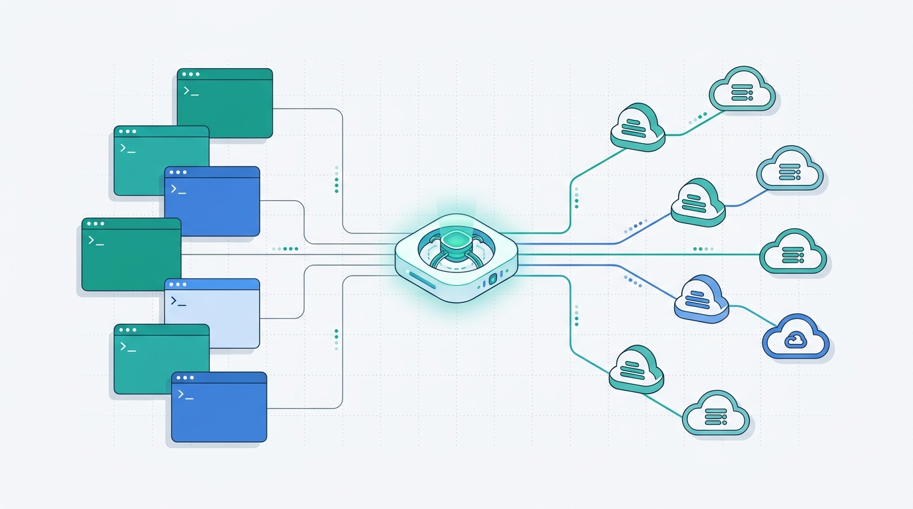
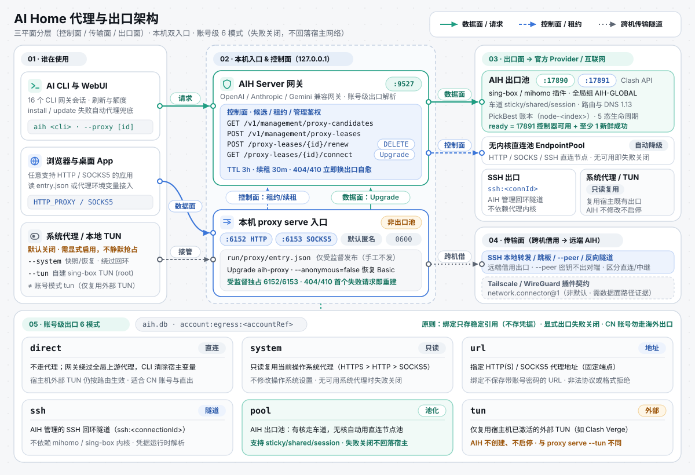

# AI Home 代理与出口功能矩阵

本文整理 AI Home（`aih`）代理与出口系统的架构分层、账号级出口模式、出口池内核与降级、受管租约控制面、本机入口与 TUN 边界、端口/文件速查以及真实排障复盘，作为查阅与验收的统一参考手册。

<p align="center">
  
  <br />
  <sub>视觉引导图（由 Gemini 3.1 Flash Image 生成，仅作封面；精确结构见下方 SVG 与矩阵）。</sub>
</p>

<p align="center">
  <a href="../assets/proxy-architecture.svg"></a>
  <br />
  <sub>图 1：AI Home 代理与出口静态架构（三平面、本机双入口、出口池与账号级 6 模式） · <a href="../assets/proxy-architecture.svg">打开原图</a></sub>
</p>

<p align="center">
  <a href="../assets/proxy-request-flow.svg"></a>
  <br />
  <sub>图 2：两条核心请求路径动态流转（支持 SVG 动画的浏览器打开原图可播放；静态首帧可读）与租约控制面自愈机制 · <a href="../assets/proxy-request-flow.svg">打开动态图</a></sub>
</p>

---

## 1. 三个平面与六层契约

AI Home 的代理系统首先把**控制、传输、出口**三个平面彻底分离，避免把管理权限、跨机链路与真实出网节点混为一谈；在账号出口引擎（`internal/runtime/egress`）内部再按**六层契约**组织代码与职责。

### 1.1 三个平面

| 平面 | 职责 | 现有实现与关键契约 |
| --- | --- | --- |
| **控制面** | 候选出口发现、租约签发/续期/回收、管理鉴权、路由/策略下发 | 挂载在 AIH Server（默认 `127.0.0.1:9527`）：`GET /v1/management/proxy-candidates`、`POST /v1/management/proxy-leases`、`POST /proxy-leases/{id}/renew`、`GET /proxy-leases/{id}/connect`（HTTP Upgrade `aih-proxy`）、`DELETE /proxy-leases/{id}`；租约 TTL `3h`、续租间隔 `30m`，`404`/`410` 视为 `lease lost` 并立即自愈。管理密钥仅用于控制面，数据面只使用租约令牌。 |
| **传输面** | 把本机的控制或数据流量送到远端 AIH 节点 | SSH 本地转发（`--ssh <connectionId>`）、SSH 跳板（`--ssh-via` / `--peer-via`）、SSH 对等借用（`--peer <connectionId>`，远端密钥不出对端）、SSH 反向隧道/中继；Tailscale / WireGuard / Cloudflare Tunnel 属于 `network.connector@1` 外部插件契约，**未作为默认传输**。 |
| **出口面** | 真正向 Provider 或互联网发起出站连接的代理/内核 | AIH 出口池（`mihomo` / `sing-box` 进程插件）、无内核直连节点池（`EndpointPool`：HTTP/SOCKS/SSH）、SSH 回环出口（`ssh:<connectionId>`）、宿主机系统代理（只读复用）、外部已激活 TUN（只读复用）。 |

### 1.2 账号出口六层契约（`internal/runtime/egress`）

| 层级 | 核心对象 / 入口 | 职责与不可变约束 |
| --- | --- | --- |
| **1. 绑定层** | `adapters/agy/egress.Binding` + `StrategyDefinition` | 声明模式、范围（`scope`）与策略；策略目录是唯一声明源。绑定只存稳定引用（无凭据 URL、pool scope/strategy、`ssh:<connectionId>`），凭据只在运行时解析，不落绑定。 |
| **2. 解析层** | `Manager.ResolveAccountEgress` / `ResolveAccountLaunchEgress` | 将账号绑定翻译为一次具体出口（`direct` / `proxy` / `pool` / `ssh`）。**显式出口失败关闭（fail-closed）**：绑定损坏、隧道/车道未就绪或无可用节点时中止请求，绝不回落宿主网络。 |
| **3. 执行层** | `PoolCore` / `EndpointPool` | 有内核插件时走 `egress.engine` 编译的车道；无内核时自动降级到 `EndpointPool`（HTTP/SOCKS/SSH 直连节点池）。 |
| **4. 规划层** | `ComputeEgressPlan` + `NodeHealthLedger` | 纯计算：结合账号、绑定、范围、策略、健康账本与地区证据计算车道与允许集合；通过 `PickBest` / `PickNext` 选路。 |
| **5. 策略层** | `RoutingPolicy` | 将 `domain` / `suffix` / `keyword` / `ip-cidr` 规则与 DNS 配置（sing-box 1.13 新格式）编译进内核。 |
| **6. 呈现层** | `BuildUpstreamsView` / `StrategyCatalog` / `Diagnostics` / WebUI | 统一输出上游视图、策略目录、诊断与 WebUI 面板状态；Surge / sing-box profile 渲染属于呈现层，不侵入代理执行层。 |

> **插件化内核边界**：`mihomo` 与 `sing-box` 均为独立进程插件（`cmd/aih-engine-mihomo`、`cmd/aih-engine-singbox`），遵循 `application/egressengine.Engine` 契约（`Descriptor` / `Compile`）；插件只负责编译配置与启动事实，宿主统一负责进程监督、控制面、健康账本、车道与回收。

---

## 2. 账号出口 6 模式矩阵

账号出口绑定保存在 `~/.ai_home/aih.db` 的 KV `account:egress:<accountRef>` 中，支持以下 6 种模式：

| 模式 | 路由去向 | 网关（9527）行为 | CLI 启动行为 | 凭据 / 系统改动 | 失败语义 | 典型适用场景与注意 |
| --- | --- | --- | --- | --- | --- | --- |
| **`direct`** | 不走代理，直出网络 | 显式绕过全局上游代理，直接出站 | 清除宿主的代理环境变量（`HTTP(S)_PROXY` 等） | 不改系统设置；若宿主机开启了外部 TUN，**外部 TUN 仍按 OS 路由生效** | 网络层失败直接返回，不代切代理 | 国内直连账号（如 CN 账号）或无需代理的本机直出环境 |
| **`system`** | 复用操作系统当前代理 | 只读探测系统代理，按优先级 **`HTTPS > HTTP > SOCKS5`** 选用 | 校验系统代理可用后将探测地址写入 CLI 代理环境 | **只读，不修改操作系统代理设置** | 系统代理未开启或不可用时 `system_proxy_unavailable` **失败关闭** | 已有常驻系统代理且希望账号跟随系统代理，但禁止静默回落直连 |
| **`url`** | 指定的 HTTP(S) / SOCKS5 代理地址 | 经指定代理转发上游请求 | 注入对应的代理环境变量 | **绑定不保存带账号密码（userinfo）的 URL**；非法 URL 或协议直接拒绝 | 地址非法或代理不可达时 **失败关闭**，不回落直连 | 固定静态代理端点（例如内网或本机第三方代理端口） |
| **`ssh`** | AIH 管理的 SSH 回环隧道（`ssh:<connectionId>`） | 通过 SSH 隧道端点转发，不依赖 `mihomo` / `sing-box` | 注入对应的回环隧道代理地址 | 绑定只存 `ssh:<connectionId>`，SSH 凭据运行时解析，不落绑定 | 隧道未就绪或连接失败时 **失败关闭** | 希望单账号独占自有 VPS / 开发机 IP，且无需部署代理内核 |
| **`pool`** | AIH 出口池（有内核走车道；无内核走直连节点池） | 有内核按车道（`sticky` / `shared` / `session`）转发；无内核自动走 `EndpointPool` | 分配对应车道或直连池端点并注入代理环境 | 绑定只存 `scope` / `strategy`，凭据与节点详情保留在池配置中 | 车道未就绪且无可用直连节点时 **失败关闭，绝不回落宿主网络** | 多节点订阅、按地区/分组隔离账号出口、需要健康选路与自动容错 |
| **`tun`** | 复用宿主机已激活的外部 TUN | 检测外部 TUN 存活后直发（交由 OS 路由进入外部 TUN） | 检测外部 TUN 存活后清除普通代理变量，交由外部 TUN 接管 | **AIH 不创建、不启停外部 TUN**（仅检测并复用，如 Clash Verge TUN） | 未检测到有效外部 TUN 时 **失败关闭** | 宿主机已运行外部 TUN 且不希望再叠一层 HTTP/SOCKS 代理。**注意：与 `aih proxy serve --tun` 完全不同**（见第 5 节） |

---

## 3. AIH 出口池矩阵

AIH 出口池承载 `pool` 账号模式与受管代理池的池化出口能力，核心能力矩阵如下：

| 维度 | 机制与规则 | 关键细节与约束 |
| --- | --- | --- |
| **订阅 / 节点 / 分组** | 统一由 `~/.ai_home/proxy-pool.json` 与 `subscription-aggregator.json` 管理 | 示例规模约 120 条记录（日志约 114 ready）。节点标签按**输入位置固定为 `node-<index>`**，不按已编译数量递增，防止不同内核跳过不同协议导致切换内核后同一逻辑节点标签错位。 |
| **内核插件与端口** | 进程插件 `cmd/aih-engine-singbox` / `cmd/aih-engine-mihomo`；生产构建使用 `-tags no_builtin_engines` | 默认 mixed 入口 **`17890`**、Clash API 控制器 **`17891`**（`/version`、`/proxies`、`PUT /proxies/{group}`、`/delay`）、全局组名 **`AIH-GLOBAL`**。运行态示例：`coreKind=plugin:sing-box`（如版本 `1.13.19`）。状态记录于 `run/egress-pool/state.json`，按 `coreKind` 选用配置文件（如 `sing-box.json`），启动后清理另一内核旧配置。 |
| **车道（Lanes）** | `sticky`（账号粘性固定车道）、`shared`（共享车道）、`session`（会话级车道） | **`sing-box`**：按车道复制路由规则，确保规则逐车道生效。**`mihomo`**：使用全局规则模式，listener 的强制出站可能优先于全局规则。 |
| **选路与健康账本** | 初始/失效车道用 **`PickBest`**；轮换用 **`PickNext`**（保证确定性顺序） | `PickBest` 偏好优先级：**新鲜成功 > 未探测 > 陈旧成功 > 新鲜失败**（陈旧成功不能当可靠事实）。健康账本落盘于 `run/egress-pool/node-health.json`，按出口身份（`node-<index>` / `ssh\|<connId>`）记账，不按显示名。死节点只作为探测与冷却输入，不改账号绑定。 |
| **路由与 DNS** | `RoutingPolicy` 支持 `domain` / `suffix` / `keyword` / `ip-cidr` → `proxy` / `direct` / `reject` | DNS 采用 **sing-box 1.13 新格式**；通过管理面接口 `/v1/management/webui/egress-upstreams/routing` 读写与下发。 |
| **无内核降级** | 当本机无可用 `mihomo` / `sing-box` 进程插件时，自动降级至 **`EndpointPool`** | `EndpointPool` 直接调度池内的 **HTTP / SOCKS / SSH 直连节点**；若既无内核插件又无可用直连节点，则严格 fail-closed，不回落宿主网络。 |
| **池生命周期** | 显式 5 状态：`stopped` / `starting` / `ready` / `degraded` / `failed` | **`ready` 成立条件**：Clash API 控制器（`17891`）可用 **且** 至少存在一个具备**新鲜成功**探测记录的节点。 |

---

## 4. 受管代理池与租约矩阵

受管代理池允许 CLI 任务、本机 `aih proxy serve` 与跨机客户端按需借用 AIH Server 管理的出口，而不暴露 Management Key 或改写全局代理配置。

### 4.1 控制面与租约生命周期

| 能力 | 接口 / 机制 | 行为与安全边界 |
| --- | --- | --- |
| **列出可用候选** | `GET /v1/management/proxy-candidates` | 按与 `NodeHealthLedger.PickBest` 一致的偏好分排序返回出口候选（含池节点、SSH 出口等）；CLI `--proxy` 的 TAB 补全只读取短缓存快照，不拨号 SSH、不建租约。 |
| **签发租约** | `POST /v1/management/proxy-leases` | 需携带 Management Key；服务端签发带独立租约令牌（lease token）的租约，默认 **TTL 3 小时**。 |
| **定期续租** | `POST /proxy-leases/{id}/renew` | 长驻入口每 **30 分钟**续租一次，保持租约有效。 |
| **数据面建连** | `GET /proxy-leases/{id}/connect` | 通过 **HTTP Upgrade `aih-proxy`** 建立数据面隧道，使用租约令牌鉴权；远端 CLI 在本机 `127.0.0.1` 建入口并通过该通道转发，不把 Server 的 `localhost` 当作客户端地址。 |
| **释放租约** | `DELETE /proxy-leases/{id}` | 正常退出、任务完成或取消时显式释放；异常崩溃残留由服务端在 3h TTL 到期后自动回收。 |
| **租约丢失自愈** | `404` / `410` → `ErrLeaseLost`（commit `de122bac`） | 服务端重启或租约被删导致 `/connect` 或续租返回 `404`/`410` 时，**在首个失败请求即刻触发自愈**：自动换下一个可用出口，重建本机入口、`entry.json`、系统代理与 TUN 路由，不再干等 30 分钟续租周期。 |

### 4.2 按地区给临时池划范围（`--proxy` 范围）

`--proxy` 与 `aih proxy serve --selector` 接受地区范围，把**临时受管代理池**限定在范围内，而不是只点一个节点：

```text
--proxy us,sg
   │
   ▼
候选池（全部出口）
   │ 按代理解析出的国家/城市过滤
   ▼
US / SG 出口 ──失败──▶ 下一个 US/SG 出口
   │
   ▼
租约 → 安装器
```

| 语法 | 含义 |
| --- | --- |
| `--proxy us,sg` | 仅美国、新加坡（2 字 ISO 3166-1 alpha-2 国家码） |
| `--proxy lax,sin` | 仅洛杉矶、新加坡（3 字 IATA 城市码） |
| `--proxy us,lax` | 国家与城市取并集 |
| `--proxy us,sg,exclude:hk` | 仅美国/新加坡，排除香港（排除优先） |
| `--proxy exclude:cn,ru` | 排除中国/俄罗斯，其余可用 |

- TAB 只列出当前候选里实际存在的码，并带中文描述；`aih proxy regions --all` 打印 2 字国家码 / 3 字城市码的完整中文表。
- 地区来源优先 `node-health.geo` 的解析国家/城市，回退节点声明的 `countryCode` / 节点名中的 IATA；解析不出地区的候选在范围过滤下**不参与（fail closed）**。
- 点名具体节点仍不轮换；地区范围在范围内轮换。范围内没有候选时明确报错，不静默回全部或直连。
- 城市码依赖候选有城市级解析；当前池没有城市数据时先用国家码，`--all` 可查完整城市码表。

### 4.3 跨机传输面与对等借用

| 传输方式 | 命令 / 契约 | 验证状态与路径证据语义 |
| --- | --- | --- |
| **SSH 本地转发** | `aih proxy serve --ssh <connectionId>` | **已真机验证**（Mac 借用 Windows Clash 出口）。自动复用已保存 SSH 连接建本地转发，无需手工 `ssh -L`；两端共享同一管理信任根。 |
| **SSH 跳板转发** | `--ssh-via <connectionId>` / `--peer-via <jumpId>` | **已真机验证**（Mac → AWS → Windows → Clash 出口）。报告 `peer-relay`（`source=ssh-jump\|ssh-egress-jump, path=via-jump`）。 |
| **SSH 对等借用（`--peer`）** | `aih proxy serve --peer <connectionId>` | **已真机验证**（Mac→Windows、Mac→AWS→Windows）。远端在自身执行 `aih proxy serve --json --exit-on-stdin-eof`，**远端 Management Key 与控制面不出对端**；无跳板时按配置报告 `direct-p2p`（`confidence=configured`），关闭 SSH stdin 即可优雅退出释放租约。 |
| **SSH 反向隧道 / 中继** | 复用 `sshtunnel` / reverse tunnel 组件 | 适用于两端均在 NAT 后、经一台可达公网中继互联的场景；公网节点代转字节必须报告 `peer-relay`。 |
| **Tailscale / WireGuard / Cloudflare Tunnel** | `network.connector@1` 外部签名插件契约 | **未作为默认传输（未安装/未验证）**。仅当插件给出可复核的数据面无中继证据时才允许报告 `direct-p2p`；DERP 中继报 `derp-relay`，Cloudflare 报 `outbound-tunnel`，握手未证明路径报 `wireguard-tunnel`。 |

### 4.4 任务级自动代理轮换（`updateproxy.RetryWithEgress`）

| 入口 | 触发规则 | 不触发反例 |
| --- | --- | --- |
| `aih <provider> install\|update`、缺 CLI 自动安装、WebUI 工具箱安装作业（含插件应用） | 未显式指定 `--proxy` 时先直连；仅当失败明确归因于**网络层错误**（DNS 失败、连接被拒/超时/重置、网络不可达、代理隧道失败）才自动申请受管出口并按候选顺序逐条轮换，且终端/作业 `attempts` 逐条告知；不改动全局配置。 | 版本不存在（`ETARGET`）、文件系统权限/重命名错误（`ENOTEMPTY`）、上游业务拒绝（`E403`）、以及用户显式传入 `--proxy <出口>`（点名出口绝不自动轮换）。 |

---

## 5. 本机入口 / 系统代理 / TUN / 按应用代理矩阵

| 形态 | 入口 / 启动方式 | 端口与认证 | 所有权与文件发布 | 重要边界 |
| --- | --- | --- | --- | --- |
| **受监督本机入口（managed）** | 由 AIH Server / WebUI（`GET/POST /v1/management/webui/proxy-serve[/start|/stop]`）通过 `--exit-with-parent` 启动 | 默认 **`6152`**（HTTP）、**`6153`**（SOCKS5），仅监听 `127.0.0.1`；默认回环匿名，`--anonymous=false` 恢复 Basic 认证 | **独占默认 `6152`/`6153`**；**只有受监督实例发布 `~/.ai_home/run/proxy/entry.json`（权限 `0600`）** | 入口会话生命周期由核心宿主唯一持有，不交由插件提供 UI；端口默认冲突回退随机，显式指定端口冲突直接报错；lease lost 立即自愈重建。 |
| **手工 `aih proxy serve`** | 终端手工执行 `aih proxy serve [flags]` | 默认尝试 `6152`/`6153`（被占时默认回退随机，显式传端口冲突报错）；默认匿名，`--anonymous=false` 恢复 Basic | **不发布 `entry.json`**；退出时自动释放租约 | 用于临时按需代理或跨机 `--ssh`/`--peer` 借用；**禁止拿手工实例抢占受监督实例的 `6152`/`6153`**。 |
| **操作系统系统代理** | `aih proxy serve --system --system-service <name>` | 额外提供仅 loopback 匿名 HTTP 入口供 OS 使用（上游仍持租约令牌认证） | 启用前快照原系统代理，退出时自动恢复原配置；自动绕过 `127.0.0.1` / `localhost` / `::1` | **默认关闭，绝不静默抢占**；WebUI 仅展示可复制命令，不静默提权改系统配置。 |
| **AIH 自建本地 TUN** | `aih proxy serve --tun`（校验用 `--tun-dry-run`） | 由 `internal/runtime/tuningress` 生成 sing-box TUN 配置，唯一出站指向本机租约入口 | 需要 **root / 管理员权限**；`--tun-dry-run` 只做 `sing-box check`，不建网卡、不改路由 | 属于显式网络层接管，与外部 TUN（Clash Verge 等）所有权冲突须显式报告，禁止静默争抢。**与账号出口模式 `tun`（仅复用外部 TUN）本质不同**。 |
| **按应用 / 任务级代理** | 浏览器/App 指向 `127.0.0.1:6152`（HTTP）或 `6153`（SOCKS5），或设置 `HTTP_PROXY` / `HTTPS_PROXY`；CLI 任务用 `--proxy` | 复用同一租约机制；不把 Management Key 写入代理 URL | 仅作用于目标应用或单次任务，不写全局配置 | Windows 任务安装器已统一处理 PowerShell `DefaultWebProxy` + `.Credentials`、移除 `ALL_PROXY`（避免 Windows `curl.exe` 报错），以及 `winget --proxy` 配合匿名回环入口与 UAC 授权开关。 |

---

## 6. 端口与文件速查表

### 6.1 端口速查

| 端口 | 所属组件 | 监听与用途 | 关键辨析 |
| --- | --- | --- | --- |
| **`9527`** | AIH Server 网关与控制面 | 默认 `127.0.0.1:9527`；OpenAI / Anthropic / Gemini 兼容网关、WebUI 与代理控制面 API | 网关与租约控制面都在此端口 |
| **`6152`** | 本机 `aih proxy serve` HTTP 入口 | 默认 loopback HTTP 代理入口（默认匿名，`--anonymous=false` 启用 Basic） | **这是本机入口，不是出口池** |
| **`6153`** | 本机 `aih proxy serve` SOCKS5 入口 | 默认 loopback SOCKS5 代理入口（同上） | **这是本机入口，不是出口池** |
| **`17890`** | AIH 出口池 mixed 代理 | 代理内核（sing-box / mihomo）混合协议入站，面向账号车道与租约数据面 | 真正的 AIH 出口池数据端口 |
| **`17891`** | AIH 出口池 Clash API 控制器 | 内核控制与健康探测 API（`/version`、`/proxies`、`PUT /proxies/{group}`、`/delay`），全局组 `AIH-GLOBAL` | `ready` 状态依赖此控制器可用 |

### 6.2 核心文件与数据位置（默认位于 `~/.ai_home/`，受 `AIH_HOME_DIR` 控制）

| 路径 | 权限 / 类型 | 作用与维护者 |
| --- | --- | --- |
| `~/.ai_home/proxy-pool.json` | JSON 配置 | 出口池节点、订阅与分组源数据（示例规模约 120 条记录、日志 114 ready） |
| `~/.ai_home/subscription-aggregator.json` | JSON 配置 | 订阅聚合器配置 |
| `~/.ai_home/run/egress-pool/state.json` | 运行时状态 | 记录当前池生命周期、`coreKind`（如 `plugin:sing-box`）、`coreVersion`（如 `1.13.19`）、`globalGroup`（`AIH-GLOBAL`）与车道映射 |
| `~/.ai_home/run/egress-pool/sing-box.json` | 编译产物 | 按 `coreKind` 选用的内核运行时配置（启动后删除另一内核的旧配置） |
| `~/.ai_home/run/egress-pool/node-health.json` | 运行时账本 | 出口健康账本，按出口身份（`node-<index>` / `ssh\|<connId>`）记录探测新鲜度与成败 |
| `~/.ai_home/run/proxy/entry.json` | **`0600`** 发现文件 | **仅由受监督实例（`--exit-with-parent`）发布**，指向当前受管入口端口；手工 `proxy serve` 不发布 |
| `~/.ai_home/run/proxy/management.key` | 密钥文件 | 代理入口侧管理面密钥引用，严禁回显到日志或提交至仓库 |
| `~/.ai_home/run/ssh-proxy-endpoints.json` | 运行时状态 | AIH 管理的 SSH 回环隧道出口端点列表 |
| `~/.ai_home/aih.db`（KV `account:egress:<accountRef>`） | SQLite KV | 账号级出口绑定记录（6 模式与范围/策略，不存明文凭据） |

---

## 7. 常见误解与 6152/6153 案例复盘

### 7.1 最常见的两个误解

1. **误解一：“`6152`/`6153` 是 AIH 的出口池端口。”**
   - **事实**：`6152`（HTTP）与 `6153`（SOCKS5）是**本机代理入口（`aih proxy serve`）**的默认端口；AIH 出口池在 **`17890`**（mixed）与 **`17891`**（Clash API 控制器）。
2. **误解二：“账号绑定 `tun` 模式就是让 AIH 开一个 TUN 网卡。”**
   - **事实**：账号出口模式 `tun` **仅复用宿主机已激活的外部 TUN**，AIH 不创建也不启停；会由 AIH 自己创建 sing-box TUN 的是显式命令 `aih proxy serve --tun`（需 root 权限）。

### 7.2 真实事故复盘：6152/6153 端口被占 + 系统代理 + 租约丢失叠加

| 阶段 | 发生的事情 |
| --- | --- |
| **1. 误判起点** | 表面现象是“访问 6152 失败、CodeBuddy 国内请求异常走海外、Server 重启后代理半小时不通”，容易被误以为是 `6152`/`6153` 端口本身不可靠。 |
| **2. 真实链路还原** | ① 曾手工执行 `aih proxy serve` 抢占了 `6152`/`6153`；<br />② 受监督（managed）服务随后启动，因 `6152`/`6153` 被占而自动回退到临时随机端口；<br />③ 操作系统系统代理仍指向 `6152`，导致 **CodeBuddy 国内请求**被错误导向海外 AWS 出口；<br />④ 接着 AIH Server 重启，原租约在服务端丢失（返回 `404`），但旧代码只在每 30 分钟续租周期才感知租约失效，导致浏览器/客户端在长达半小时内持续报上游代理不可用。 |
| **3. 现在的状态** | ① **端口所有权收口**：受监督（managed）实例独占 `6152`/`6153`，并由其发布 `run/proxy/entry.json`（`0600`）明确指向这两个端口；手工 `proxy serve` 不发布 `entry.json`；<br />② **系统代理默认关闭**：不再挂着全局系统代理误伤国内应用，需显式 `--system` 才启用并在退出时恢复快照；<br />③ **租约丢失立即自愈**（commit `de122bac`）：`/connect` 返回 `404`/`410` 标记为 `ErrLeaseLost`，在**首个失败请求**立即换出口并重建入口与 `entry.json`，无需等待 30 分钟续租。 |
| **4. 复盘结论** | **端口本身没问题**，根因是 **「端口所有权 + 系统代理 + 租约状态」三者叠加**；同时必须坚持：**CN 账号不要走海外出口**。 |

---

## 8. 边界与不要做的事

1. **CN 账号不要走海外出口**：`codebuddycn`、`workbuddycn`、`qodercn` 等国内账号应使用 `direct` 或合规国内策略，避免因系统代理或误绑海外出口导致风控、地区不匹配或登录异常。
2. **系统代理默认关闭，禁止静默抢占**：不要在后台默认篡改操作系统代理设置；确需系统级接管时显式运行 `aih proxy serve --system --system-service <name>`，确保退出恢复快照且始终绕过 `127.0.0.1` / `localhost` / `::1`。
3. **守住手工 `proxy serve` 的边界**：不要用手工 `aih proxy serve` 抢占受监督实例的 `6152`/`6153`；自动化工具发现本机受管入口应读取受监督实例发布的 `run/proxy/entry.json`（`0600`）。
4. **不要混淆外部 TUN 与自建 `--tun`**：账号 `tun` 模式只读复用外部 TUN；`proxy serve --tun` 会创建 sing-box TUN 接管系统路由（需 root），使用前先用 `--tun-dry-run` 校验，不得与 Clash Verge 等外部 TUN 静默争抢所有权。
5. **严格遵守 P2P 路径证据契约**：**“有公网 endpoint” ≠ P2P，“连接成功” ≠ 直连**。只有在具备可复核的数据面无中继证据时才能标为 `direct-p2p`；SSH 跳板报 `peer-relay`，厂商中继报 `derp-relay`，纯 HTTP 出站隧道报 `outbound-tunnel`，UI 必须同时呈现 `pathConfidence` 与 `pathEvidence`。
6. **严守凭据与失败关闭底线**：Management Key 只走控制面，数据面只持租约令牌；账号 `url` 绑定不保存带账号密码的 URL；日志、错误信息与代码提交中严禁出现管理密钥、租约令牌或节点凭据；显式账号出口失败一律 fail-closed，绝不静默回落宿主网络。
7. **非目标能力不塞进代理层**：MITM、脚本钩子、Apple 生态专用入口不在 `internal/runtime/egress` 包内；MITM 需要独立的证书与 TLS 安全设计，不得作为普通代理策略顺手实现。

相关深入文档：
- 跨机代理借用与 P2P 边界设计：[proxy-borrowing-and-p2p.md](proxy-borrowing-and-p2p.md)
- 自动代理（auto egress）与 Windows 真机验证记录：[auto-egress-verification.md](auto-egress-verification.md)
- 账号出口调用链审计与修复记录：[egress-entry-points.md](egress-entry-points.md)
