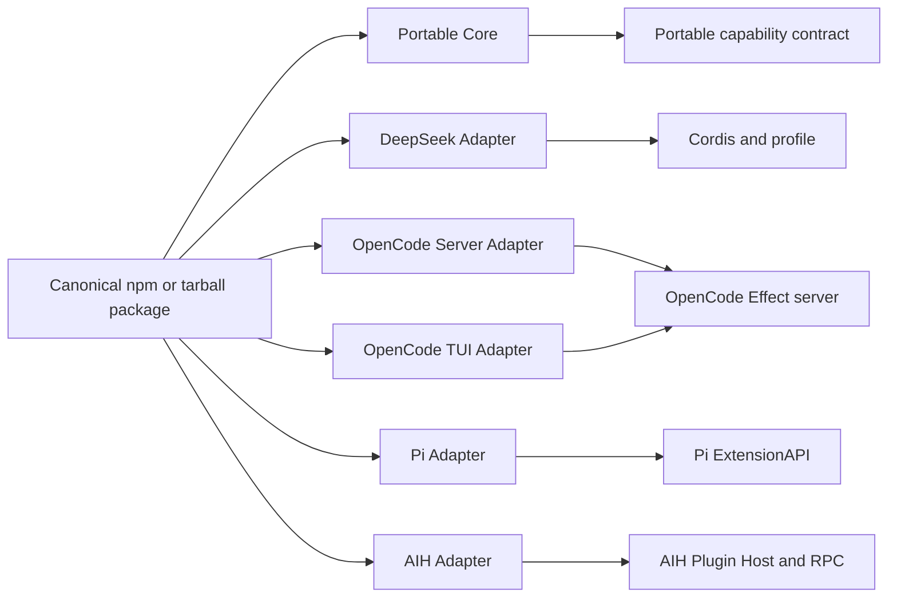

# Universal Agent Plugin Architecture

日期：2026-10-25

状态：设计已确认；管理能力和跨宿主投影已落地，Pi/DeepSeek 的原生包管理与 SDK 工具生命周期已有证据，统一 AIH 管理接入仍在推进

范围：DeepSeek Harness、OpenCode、Pi Agent 与 AIH 的统一插件发行与宿主适配

## 1. 决策摘要

采用 **Portable Core + Host Adapter + Native Projection**。

一个插件包包含一份不依赖宿主的 Portable Core，以及 DeepSeek Harness、OpenCode、Pi 和 AIH 的薄适配器。Portable Core 只依赖稳定的能力端口和数据合同；每个适配器负责把本宿主的生命周期、事件、工具、命令、状态与 UI API 投影到这些端口。安装仍由各原生宿主拥有，跨宿主工具只负责校验 canonical manifest、生成宿主投影和输出兼容报告。

不采用一个让第三方插件继承的跨宿主巨型超类。四个宿主的最小运行单元不同：DSH 是 Cordis Fiber 与 profile patch，OpenCode 是 Effect Scope 与 generation，Pi 是 extension factory 与 session lifecycle，AIH 是受监督 Plugin Host、RPC 与 generation。用一个父类表示它们会隐藏真实差异，并把宿主专用能力错误地伪装成公共能力。若需要复用状态机和清理逻辑，只在适配器内部使用抽象基类；第三方插件面向接口、端口和能力声明。

## 2. 目标与非目标

### 2.1 目标

1. 同一个 npm 或 tarball 发行包可被 DSH、OpenCode、Pi 和 AIH 安装。
2. 插件业务逻辑只实现一次，宿主差异集中在适配器。
3. 公共能力有版本、有生命周期、有权限边界和可验证的能力协商。
4. 宿主专用能力保持真实语义：AIH gateway/account、OpenCode Effect/session、Pi TUI、DSH profile/Cordis 等不被伪装成跨宿主能力。
5. AIH 继续支持离线制品、摘要、签名、受监督进程、generation 和 Go 投影。
6. 插件升级时在途请求继续使用旧快照，插件停用可以排空并等待异步清理。
7. 兼容报告能逐宿主、逐能力回答 supported、partial、unsupported 和原因。

### 2.2 非目标

1. 不统一四个宿主的 Agent loop、SessionStore、凭据库或账号域。
2. 不把 AIH 作为其他宿主运行插件的强制远程代理。
3. 不在第一版提供任意 HTTP/WS 原始字节中间件。
4. 不让 Portable Core 直接读宿主凭据、数据库、内部 Store 或完整环境。
5. 不把 MCP 当作完整插件生命周期协议；MCP 只能作为工具能力的一个适配来源。
6. 不在公共层承诺所有宿主的 Provider、UI、Session、Gateway 和 Account 能力。

## 3. 外部平台事实与设计启示

### 3.1 DeepSeek Harness

DeepSeek Harness 使用 Cordis，并以 profile/bundle 组织插件组合。bundle 是 npm 包，通常在 `package.json` 的 `dsh.bundle.patch` 声明 patch 文件；profile 在自身 `package.json` 的 `dsh.profile.bundles` 中维护 bundle 顺序。加载时先完成包、版本与依赖检查，再按 patch 层组合 Loader tree，Cordis 负责 `Context`、`inject`、Fiber、effect 和资源回收。

可吸收的部分：依赖图、声明式组合、资源随 Fiber 清理、profile 与 bundle 分离、安装前兼容性预检。不能直接吸收为公共 API 的部分：Cordis Context 类型、DSH profile patch 语法、DSH Agent/Session/UI 服务。

源码依据：DeepSeek Harness `22ddee3792402c3e70ec5f86a63c3e3e895a2f60`，主要包括 `packages/boot/plugin-manager`、`packages/boot/app-boot/src/profile.ts`、`profile-plugins.ts`、`plugin-compatibility.ts` 与 vendor Cordis。

### 3.2 OpenCode

OpenCode 使用 npm 或本地插件来源，并可解析 `server`、`tui`、`rpc` 等入口。server 插件通过 Effect 风格的插件上下文访问 Session、Tool、Provider、Command、Credential、Storage 等领域 API；插件生命周期由 Scope 和 generation 管理，更新时准备新 generation，失败时保留可用旧实例或记录失败。OpenCode 还拥有独立 GUI extension manifest 和 main/renderer 生命周期，不能与 server plugin 混称。

可吸收的部分：明确的入口分面、Scope 资源拥有、generation 更新、插件域 API、host withdraw 先于异步清理。不能直接吸收为公共 API 的部分：Effect 类型、OpenCode Session/Provider schema、OpenCode GUI/renderer contract。

源码依据：OpenCode `9cbdffcb06f8fb567b90c28cfe5cb20850115660`，主要包括 `packages/plugin/src/effect/plugin.ts`、`packages/plugin/src/promise/plugin.ts`、`packages/core/src/plugin/module.ts`、`packages/core/src/plugin.ts`、`packages/core/src/config/plugin/source.ts` 与 desktop extension lifecycle。

### 3.3 Pi Agent

Pi 使用 extension factory：模块默认导出接收 `ExtensionAPI` 的函数，通过 `on`、`registerTool`、`registerCommand`、Provider 注册、Session 事件和 TUI API 注册能力。Pi package 可以来自 npm、git 或本地路径，`package.json` 的 `pi` 字段可声明 extensions、skills、prompts 和 themes；同时支持项目目录和用户目录发现。项目扩展在 trust 之后加载，扩展可在 `session_shutdown` 清理资源。

可吸收的部分：轻量 factory、事件/工具/命令的窄注册 API、package 资源声明、项目 trust、扩展运行时 owner。不能直接吸收为公共 API 的部分：Pi `ExtensionAPI`、TUI renderer、Pi session manager、Pi virtual model 和 Pi 专用 provider 类型。

源码依据：Pi `38ff99177fba21e9c57a670f4e95adcf407c99c7`，主要包括 `packages/coding-agent/docs/extensions.md`、`docs/packages.md`、`src/core/extensions/loader.ts`、`types.ts` 和 `runner.ts`。

### 3.4 AIH 当前实现

AIH 已有以 Cordis 为内部生命周期、以本机 RPC 为宿主边界的插件底座：离线 `.aih-plugin` 制品、文件级摘要、签名、权限、受监督 Plugin Host、候选 generation、generation drain、Go 投影和 gateway/account/provider 能力均已有实现或合同基础。

当前 AIH SDK 仍是 AIH 专用 SDK：类型直接导入 `@deepseek-ai/cordis`，manifest 的 `engines` 以 `aih` 为必填宿主，`plugin.json` 是 AIH 专用格式。因此它应被保留并迁移到 `plugin-adapter-aih`，不能直接作为跨宿主格式。

当前代码依据：`lib/plugins/host/`、`lib/plugins/control/`、`lib/plugins/transport/`、`lib/plugins/sdk/`、`contracts/plugins/`、`examples/plugins/` 以及 [2026-09-30 插件架构规划](../../plans/2026-09-30-plugin-architecture-plan.md)。

## 4. 总体架构



### 4.1 Portable Core

Portable Core 只依赖本方案定义的类型、序列化 DTO 和能力端口。它不得导入：

- `@deepseek-ai/cordis`；
- OpenCode `effect` 或 `@opencode/*`；
- Pi `ExtensionAPI` 或 Pi TUI 包；
- AIH `lib/`、内部 Store、Gateway、Account 或 Server 模块。

建议接口如下，最终字段以 M0 schema 定稿：

```ts
export interface PortablePluginDefinition {
  readonly id: string
  readonly version: string
  readonly capabilities: readonly CapabilityDeclaration[]
  readonly setup: (context: PortableContext) => void | Cleanup | Promise<void | Cleanup>
}

export interface PortableContext {
  readonly host: HostInfo
  readonly signal: AbortSignal
  readonly scope: PluginScope
  readonly events: EventPort
  readonly commands?: CommandPort
  readonly tools?: ToolPort
  readonly storage?: PrivateStoragePort
  readonly model?: ModelPort
}

export type Cleanup = () => void | Promise<void>
```

`PortableContext` 是 capability-gated。插件没有声明或宿主没有提供的端口必须是 `undefined` 或明确的 capability error，不能返回一个不产生效果的假对象。

### 4.2 Host Adapter

每个宿主实现独立适配器：

```ts
export interface HostAdapter {
  readonly hostId: 'deepseek' | 'opencode' | 'pi' | 'aih'
  preflight(manifest: PortableManifest, nativeContext: unknown): Promise<CapabilityReport>
  activate(plugin: PortablePluginDefinition, nativeContext: unknown): Promise<Cleanup>
  projectManifest(manifest: PortableManifest): HostManifestProjection
}
```

适配器的职责是：

1. 检查宿主版本、入口、权限和能力；
2. 创建宿主 scope，并把 Portable Context 绑定到 scope；
3. 适配事件、命令、工具、存储和模型端口；
4. 把注册归属到当前插件并在停用时撤销；
5. 把异常、取消、超时和清理结果转换成统一诊断；
6. 生成宿主需要的 manifest、patch 或入口文件。

适配器内部可以共享一个 `ScopedHostAdapterBase`，复用状态机、注册拥有关系、drain 和清理逻辑。该基类不进入第三方 SDK，也不要求插件继承。

### 4.3 Native Projection

canonical manifest 是作者维护的唯一跨宿主声明。宿主清单是构建或安装阶段生成的 projection：

| 宿主 | projection |
|---|---|
| DSH | `dsh.bundle.patch`、bundle package metadata、profile compatibility |
| OpenCode | `server`、`tui`、`rpc` package entrypoint 与 OpenCode plugin config |
| Pi | `pi.extensions`、package resource fields 与 extension entrypoint |
| AIH | 当前 `.aih-plugin` 的 `plugin.json` 兼容投影、artifact metadata、signature |

投影器必须检查生成结果与 canonical capability 声明一致。禁止作者为了“让某一宿主能加载”手工维护一份语义不同的第二 manifest。

## 5. Canonical Manifest 与包结构

### 5.1 版本字段

不得继续复用一个 `protocolVersion` 表示所有版本。canonical manifest 至少拆出：

```text
manifestVersion           清单格式版本
portableApiVersion        Portable Context 与能力 API 版本
hostAdapterApiVersion     某宿主 adapter 的 API 版本
transportProtocolVersion  RPC/IPC 线协议版本，仅 AIH 等需要跨进程的宿主使用
pluginVersion             插件发布版本
```

### 5.2 package.json

推荐：

```json
{
  "name": "@example/review-plugin",
  "version": "1.0.0",
  "type": "module",
  "agentPlugin": {
    "manifestVersion": 1,
    "portableApiVersion": 1,
    "pluginId": "example.review-plugin",
    "core": "./dist/core.mjs",
    "engines": {
      "deepseek": ">=0.2.1",
      "opencode": ">=2.1.0",
      "pi": ">=1.4.0",
      "aih": ">=1.0.0"
    },
    "capabilities": [
      { "id": "lifecycle", "version": 1, "required": true },
      { "id": "events.observe", "version": 1, "required": true },
      { "id": "command.register", "version": 1, "required": false },
      { "id": "tool.register", "version": 1, "required": false }
    ],
    "permissions": {
      "network": [],
      "filesystem": ["private-state"],
      "secrets": []
    }
  },
  "exports": {
    ".": "./dist/core.mjs",
    "./deepseek": "./dist/hosts/deepseek.mjs",
    "./server": "./dist/hosts/opencode-server.mjs",
    "./opencode/server": "./dist/hosts/opencode-server.mjs",
    "./opencode/tui": "./dist/hosts/opencode-tui.mjs",
    "./pi": "./dist/hosts/pi.mjs",
    "./aih": "./dist/hosts/aih.mjs"
  },
  "pi": {
    "extensions": ["./dist/hosts/pi.mjs"]
  }
}
```

DSH 的 patch projection 和 AIH `plugin.json` projection 应由构建工具生成或由安装器在接受前验证，不成为另一份作者维护的事实源。

OpenCode 的 canonical 分面名 `./opencode/server` 同时需要原生 loader 的
`./server` export（或等价 `main`）。只有前者、缺少后者时不能报告 projection-ready。
同样，Pi 的 `pi.extensions` 必须列出 canonical 入口，DSH 的 `dsh.bundle.patch`
必须存在并引用包的 DeepSeek 入口；单独的 `exports` 文件存在不足以满足宿主发现。

### 5.3 目录布局

```text
dist/
  core.mjs
  hosts/
    deepseek.mjs
    opencode-server.mjs
    opencode-tui.mjs
    pi.mjs
    aih.mjs
    deepseek/cordis.patch.yml
```

核心业务逻辑只进入 `core.mjs`。宿主入口可以包含 adapter 依赖和宿主类型，但不能把宿主对象泄露回 Portable Core。

## 6. Capability Contract

### 6.1 第一批公共能力

| capability | 版本 | 语义 | 阶段 |
|---|---:|---|---|
| `lifecycle` | 1 | activate/deactivate、AbortSignal、幂等清理 | M0 |
| `events.observe` | 1 | best-effort 观察，异常隔离，不能 veto | M0 |
| `command.register` | 1 | 注册宿主命令或 slash command | M0 |
| `tool.register` | 1 | 注册模型可调用工具 | M0 |
| `storage.private` | 1 | 插件私有 JSON 状态 | M0 |
| `events.transform` | 1 | 有序 waterfall/serial 变换 | M1 |
| `session.lifecycle` | 1 | start/shutdown/resume/fork | M1 |
| `model.request.transform` | 1 | 请求前变换模型调用上下文 | M1 |

### 6.2 宿主专用能力

| 宿主 | 专用能力 |
|---|---|
| AIH | `gateway.request`、`gateway.account`、`gateway.attempt`、`model.catalog`、`account.*`、`provider.descriptor`、`quota.*`、`usage.*` |
| OpenCode | Provider/Session/Effect、OpenCode server/TUI/RPC、OpenCode GUI extension |
| Pi | Pi TUI renderer、custom editor、virtual model、Pi-specific session operations |
| DSH | Cordis `inject`、profile patch、bundle layer、DSH-specific Agent/Session/UI services |

宿主专用能力可以由同一 package 提供，但只在对应 adapter 中声明为可用。Portable Core 使用 capability negotiation 判断是否启用可选功能。

### 6.3 能力状态

```ts
type CapabilityStatus = 'supported' | 'partial' | 'unsupported' | 'incompatible'

interface CapabilityReport {
  host: string
  status: 'ready' | 'partial' | 'rejected'
  capabilities: Record<string, {
    status: CapabilityStatus
    version?: number
    reason?: string
  }>
}
```

规则：

- required capability 缺失，激活前拒绝；
- optional capability 缺失，插件可以 partial 激活；
- host-specific capability 不阻止其他宿主安装；
- unsupported 必须可观察，不能用空实现伪装支持；
- capability report 不泄露凭据、配置秘密或内部路径。

## 7. 生命周期、调用和错误语义

### 7.1 生命周期状态机

```text
discovered → preflight → prepared → active → draining → disposed
                         ↘ rejected
                         active → failed → disposed
```

统一要求：

1. 资源和注册均归属插件 scope；
2. 停用先撤销可见贡献，再等待异步 cleanup；
3. cleanup 幂等，超时有明确诊断；
4. 每个异步操作携带 AbortSignal；
5. 单个插件错误不能破坏其他插件；
6. 请求绑定 immutable generation/snapshot；
7. 插件不能自行重试、重复计费、改变账号资格或拥有第二套领域真相。

### 7.2 调用类型

公共 pipeline 明确区分：

- observer：best-effort，后续 observer 继续执行；
- transform：前一项输出作为后一项输入，输出后重新校验；
- serial policy：可等待，失败按 capability 声明拒绝或 delegate；
- middleware：单次 `next`，进入顺序与返回顺序相反；
- command/tool：副作用由宿主执行器持有，插件只通过端口请求。

Portable Core 不直接处理流式原始字节。流和背压继续由宿主拥有；跨进程 AIH 只传有界 DTO、事件摘要和受控 payload。

### 7.3 失败策略

错误至少分类为：

```text
manifest_invalid
host_incompatible
capability_missing
permission_unacknowledged
entrypoint_invalid
setup_failed
invocation_timeout
invocation_cancelled
cleanup_timeout
generation_draining
```

插件失败记录 `pluginId`、host、adapter、capability、generation、invocationId 和安全诊断。原始 token、secret、完整请求正文和环境变量不进入诊断。

## 8. 宿主适配器职责

### 8.1 DSH Adapter

- 从 canonical manifest 生成 `dsh.bundle.patch`；
- 将 Portable `setup` 绑定到 Cordis plugin/fiber；
- 用 `inject` 映射 capability 依赖；
- 用 `effect` 绑定注册和 cleanup；
- 保留 profile bundle 顺序和用户 patch 优先级；
- 在 profile/package compatibility 阶段拒绝不兼容插件。

DSH Adapter 不把 DSH SessionStore 或 UI slot 暴露为 Portable 默认能力。

### 8.2 OpenCode Adapter

- 生成 server、TUI、RPC 入口；
- 以 Effect Scope 作为 Portable scope；
- 将 OpenCode Session、Tool、Command、Provider 等映射为可选端口；
- generation 更新时 withdraw 贡献，再关闭旧 scope；
- server/TUI 分开报告能力，不能用 server 入口冒充 TUI 支持。

OpenCode GUI extension 使用自己的 manifest 和 main/renderer lifecycle；如果未来支持 GUI，作为独立 `opencode.gui` adapter，不塞进 server adapter。

### 8.3 Pi Adapter

- 以 factory 接收 Pi `ExtensionAPI`；
- 将 `pi.on` 映射为 `events`；
- 将 `registerTool`、`registerCommand` 映射为 Portable ports；
- 以 Pi extension owner 和 `session_shutdown` 管理 cleanup；
- 按 Pi package 的 trust、global/project scope 和资源筛选规则加载。

Pi Adapter 不把 Pi 专用 TUI Component 类型泄露给 Portable Core。

### 8.4 AIH Adapter

- 保留现有 Plugin Host、Cordis、RPC、generation 和 artifact supervisor；
- 将 Portable Core 装载到受监督 AIH Host；
- 将 AIH gateway/account/provider 能力作为 AIH-only ports；
- 继续执行 manifest、摘要、签名、权限、配置、expectedRevision 和 generation 发布；
- 让 Node 与 Go 使用同一个 generation projection；
- 对在途请求执行 drain，禁止新请求进入 draining generation。

当前 `lib/plugins/sdk/` 中的 Cordis 扩展类型移入 AIH Adapter；公共 core SDK 不直接依赖 Cordis。

## 9. 安装、升级、回滚

### 9.1 安装

各宿主保留原生安装命令：

```bash
dsh plugin --profile demo add @example/review-plugin
opencode plugin add @example/review-plugin
pi install npm:@example/review-plugin
aih plugin install example.review-plugin-1.0.0.aih-plugin
```

共享工具执行 `validate → project → report`，不替代宿主 package manager。

### 9.2 AIH 制品接受

AIH 继续使用当前接受链：

1. 私有复制；
2. 整体摘要与每文件摘要校验；
3. manifest、权限和签名校验；
4. 原子写入 accepted artifact；
5. 私有目录校验解压；
6. 以 digest 命名 extracted 目录。

canonical package 可以由 `aih plugin pack` 生成 AIH artifact；作者不再需要手工维护一份与 `agentPlugin` 不一致的 `plugin.json`。

### 9.3 generation 发布

1. 读取当前 revision，生成候选；
2. 校验 host、adapter、capability、配置、权限和状态 schema；
3. 准备新 scope/generation；
4. Node/Go 入口确认可调用；
5. 用 expectedRevision CAS 提交；
6. 新请求使用新 generation；
7. 在途请求继续使用旧 generation；
8. 旧 generation drain 后等待 cleanup 并回收。

候选失败不覆盖当前版本。不可逆状态迁移不能只靠切回旧代码宣称回滚成功，必须提供迁移失败诊断、快照或补偿策略。

## 10. AIH 现有体系迁移

目标目录分层：

```text
@ai-home/plugin-core
  ├── portable manifest
  ├── portable context
  ├── capability declarations
  ├── lifecycle/cleanup contract
  └── host-neutral DTO

@ai-home/plugin-adapter-aih
  ├── Cordis integration
  ├── Plugin Host RPC
  ├── generation
  ├── gateway/account/provider ports
  └── current .aih-plugin projection

@ai-home/plugin-adapter-deepseek
@ai-home/plugin-adapter-opencode
@ai-home/plugin-adapter-pi
```

迁移规则：

1. 保留现有 AIH artifact、signature、control、host、transport 和 generation 实现；
2. 公共 SDK 从 Cordis 依赖中拆出；
3. 旧 AIH `plugin.json` 保留读取兼容；
4. 新插件以 `package.json.agentPlugin` 为 canonical manifest；
5. `provider.descriptor`、`account.*`、`gateway.*` 明确标记为 AIH-only；
6. 先迁移 Echo 和 Provider Descriptor sample，再迁移账号插件；
7. 不把账号凭据、SessionActor 或 gateway truth 复制到 Portable Core。

## 11. 实施阶段与验收门禁

### M0：公共合同

交付：canonical manifest schema、capability registry、版本字段拆分、Portable Context、lifecycle contract、host capability report、conformance harness、无宿主依赖的 sample。

门禁：sample 不导入 Cordis/Effect/Pi/AIH；四个 adapter 都能 preflight；required/optional capability 缺失有明确诊断；schema 可生成 Node/Go 类型。

### M1：AIH Adapter 抽离

交付：`plugin-core`、`plugin-adapter-aih`、canonical → AIH projection、旧 manifest 兼容读取、新 sample 通过现有 Host。

门禁：旧 AIH sample 的安装、签名、权限、generation、重启恢复仍通过；没有第二份 AIH 状态真相；generation drain 和 cleanup 证据保留。

### M2：Pi 与 OpenCode

交付：Pi extension adapter、OpenCode server/TUI adapter、npm/tarball 包结构和真实安装测试。

门禁：同一包在 Pi 与 OpenCode 安装；同一 Portable Core 逻辑被调用；注册、reload、session replacement、失败和清理均可观察；不支持能力显示 partial/unsupported。

### M3：DeepSeek Harness

交付：DSH bundle/profile projection、Cordis adapter、兼容性检查、bundle 顺序和停用回收测试。

门禁：同一包可被 `dsh plugin add` 安装；profile layer 可检查；依赖缺失在运行前诊断；Fiber/effect 清理有证据。

### M4：宿主专用扩展与发行闭环

交付：AIH gateway/account/provider、OpenCode Provider/Session/UI、Pi Provider/Session/TUI、DSH UI/service、package verify/doctor、签名、升级/回滚和跨平台矩阵。

门禁：每个宿主的 capability matrix 有真实安装/调用/卸载证据；在途调用跨升级保持 generation 归属；权限和秘密不出现在日志；POSIX 与 Windows 验证完成。

## 12. 设计模式审查

| 模块 | 模式 | 原因 | 计划验证 |
|---|---|---|---|
| Portable Core | Ports and Adapters / Hexagonal Architecture | 核心逻辑隔离四个宿主 | core 包依赖扫描、四宿主 conformance |
| host adapters | Adapter | 把原生 API 投影成 Portable ports | 每个 adapter 的 install/activate/dispose 测试 |
| capability registry | Registry + Capability Negotiation | 新能力通过声明进入，避免中央派发分支 | manifest/schema/兼容矩阵测试 |
| event/request pipeline | Chain of Responsibility | 区分 observer、transform、serial、middleware | 顺序、异常隔离、单次 next 测试 |
| package installation | Projection + Facade | 一份 canonical manifest 生成宿主投影 | projection round-trip 和 drift guard |
| lifecycle | Scoped Resource + State Machine | 统一资源拥有、排空和清理 | cleanup、取消、超时、失败恢复测试 |
| AIH generation | Revisioned Snapshot | 在途请求固定旧代次 | Node/Go generation 和升级测试 |
| adapter selection | Strategy + Registry | 按 host 选择适配器，核心无宿主分支 | adapter registry、未知 host 拒绝测试 |

SOLID 评审：单一职责由 core/adapter/projection 分层保证；依赖倒置由 Portable ports 保证；接口隔离由 capability-gated ports 保证；开放封闭由 capability registry 和 adapter registry 保证。

KISS/YAGNI 评审：没有引入跨宿主大基类、统一 SessionStore、统一 UI 或远程插件市场；第一版只实现宿主交集，其余能力保持宿主专用。

## 13. 当前实现证据与后续门

本 spec 是正式设计和验收边界；当前实现按“能力子集先行”的决策交付，运行时状态必须与投影状态分开报告。可复核的证据集中在 [插件管理闭环证据](../../architecture/plugin-management-closure.md)、[Provider 资源闭环矩阵](../../architecture/provider-resource-closure-matrix.md) 和仓库内的 deterministic demos。

| 范围 | 当前状态 | 可复核证据 |
|---|---|---|
| Portable manifest、host entry、DeepSeek/Pi projection | 已交付 | `aih native plugin inspect/project examples/native-plugins/aih-demo --host deepseek\|pi`；`test/portable-plugin-conformance.test.js` |
| AIH plugin lifecycle | 运行时已验证 | `node scripts/plugin-closure-demo.js --json`：pack/install/enable/use/restart/use-after-restart/disable/uninstall/doctor |
| Codex、Claude、OpenCode native plugin projection | 运行时已验证（OpenCode 以 server/local projection 为边界） | `node scripts/native-plugin-demo.js` |
| Codex、Claude、OpenCode skill native use | 运行时已验证 | `node scripts/skill-native-demo.js --provider ...` |
| Codex、Claude、OpenCode、Cline MCP tool calls | 真实本地 stdio tool call 已验证 | `node scripts/mcp-native-demo.js` |
| DeepSeek Harness/Cordis adapter | 原生包管理与 SDK 工具生命周期已验证；统一 AIH lifecycle 尚待接入 | `scripts/deepseek-plugin-native-demo.mjs`：profile add/remove/dump、ToolRuntime 调用、Fiber 撤销与 cleanup |
| Pi extension runtime | 原生包管理和统一 AIH host lifecycle 已接入；工具、命令、shutdown 与账号隔离启动已验证 | `scripts/pi-plugin-native-demo.js --managed`：真实 AIH CLI、Pi SDK loader、四阶段、旧 handler 失效 |
| OpenCode TUI/RPC | 未独立验证 | server/local projection 已验证，TUI/RPC 需分别安装和探测 |

因此，安装包形状或 `project` 成功不能升级为宿主运行成功；只有真实宿主加载、调用、停用和移除证据才能把状态写成 `supported`。未知宿主必须保留 `unsupported`、`projection-only` 或 `runtime-unavailable` 及其原因，不能用空适配器伪装支持。

后续 M2/M3/M4 门禁仍按本文件执行：DSH 需把已验证的原生安装与 SDK adapter 接入统一 AIH 管理；Pi/DSH 继续验证真实 agent loop；OpenCode TUI/RPC 需独立准备入口和运行证据。`provider doctor` 现在按外部 harness 描述符查找已安装的 package（包括 pnpm store），并用 CLI 版本 probe 判断是否可运行，不再把不在 PATH 等同于未安装。未接入统一管理或未验证的能力仍保持显式边界。
